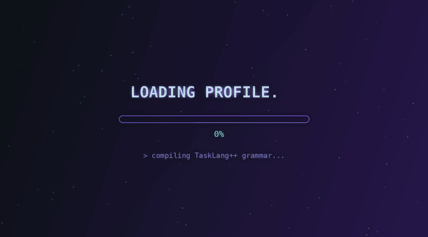
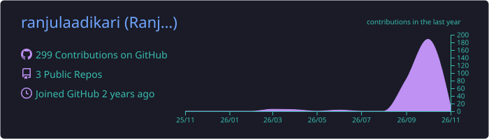
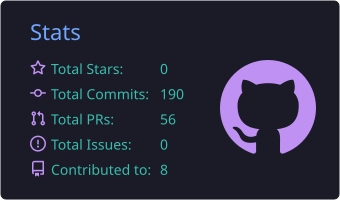
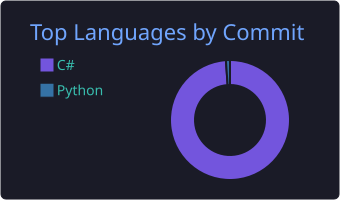

<!-- Animated wave banner -->

  

<!-- Typing animation -->

  

<!-- Quick badges -->

  
  
  
  

---

## 👋 About me

I'm a Computer Science undergraduate at **SLIIT** who likes understanding how things work under the hood — from writing a lexer and parser for my own language, to splitting a system into microservices, to keeping replicated servers in sync. I enjoy working in teams and turning assignment ideas into things that actually run.

- 🔭 **Recently built:** TaskLang++, a task-scheduling language with its own grammar
- 🌱 **Learning:** distributed systems, event-driven design with Kafka, cloud deployment
- 🎮 **Also into:** game development with Unity and game AI
- 🤝 **Open to:** internships and collaborating on interesting projects

 

---

## 🧰 Tech stack

**Languages**

**Frontend & Backend**

**Data, Cloud & DevOps**

**Game Dev & Tools**

---

## 🚀 Featured projects

<table>
  <tr>
    <td width="50%" valign="top">
      <h3>🗓️ <a href="https://github.com/ranjulaadikari/tasklang-plus-plus">TaskLang++</a></h3>
      
My own domain-specific language for scheduling and automating tasks. Supports time-based schedules, <code>AFTER</code> dependencies, <code>IF success / failure</code> conditions, and detects circular dependencies — with a Flex lexer and a Bison grammar.

      
      
      
    </td>
    <td width="50%" valign="top">
      <h3>🎲 <a href="https://github.com/ranjulaadikari/Yahtzee-Game-in-C">Yahtzee in C</a></h3>
      
A terminal-based Yahtzee dice game where you play against an AI opponent that decides which dice to keep and where to score.

      
      
    </td>
  </tr>
  <tr>
    <td width="50%" valign="top">
      <h3>🚚 <a href="https://github.com/IT24610781/smart-fleet-logistics-management-system">Smart Fleet & Logistics</a></h3>
      
Team project: a microservice-based platform for managing vehicles, drivers, trips, dispatch and live tracking, with separate Auth, Fleet, Dispatch and Telemetry services.

      
      
      
      
      
    </td>
    <td width="50%" valign="top">
      <h3>🤖 <a href="https://github.com/IT24610781/last-light-research-station">Last Light Research Station</a></h3>
      
Team project: a first-person Unity game set in a research station, featuring intelligent robot agents.

      
      
    </td>
  </tr>
  <tr>
    <td width="50%" valign="top">
      <h3>💬 <a href="https://github.com/DilooshaRajapaksha/DS---Messaging-System">Distributed Messaging System</a></h3>
      
Team project: a messaging system running across three replicated servers, covering replication, consistency, time synchronisation and consensus.

      
      
    </td>
    <td width="50%" valign="top">
      <h3>🏨 <a href="https://github.com/DilooshaRajapaksha/Hotel-Restaurant-managing-system">Hotel & Restaurant System</a></h3>
      
Team project for a real client in Dambulla: hotel management plus a delivery system for the restaurant.

      
      
      
    </td>
  </tr>
</table>

  

---

## 📊 GitHub activity

<!-- Cards generated by .github/workflows/summary-cards.yml -->

  

  
  

  

<!-- Contribution snake (needs .github/workflows/snake.yml) -->

  <picture>
    <source media="(prefers-color-scheme: dark)" srcset="https://raw.githubusercontent.com/ranjulaadikari/ranjulaadikari/output/github-snake-dark.svg" />
    <source media="(prefers-color-scheme: light)" srcset="https://raw.githubusercontent.com/ranjulaadikari/ranjulaadikari/output/github-snake.svg" />
    
  </picture>

---

## 📫 Let's connect

<!-- Replace YOUR_LINKEDIN with your LinkedIn handle, or delete that badge -->

  
  
  

<i>Thanks for stopping by — always happy to team up on something interesting.</i>

  

